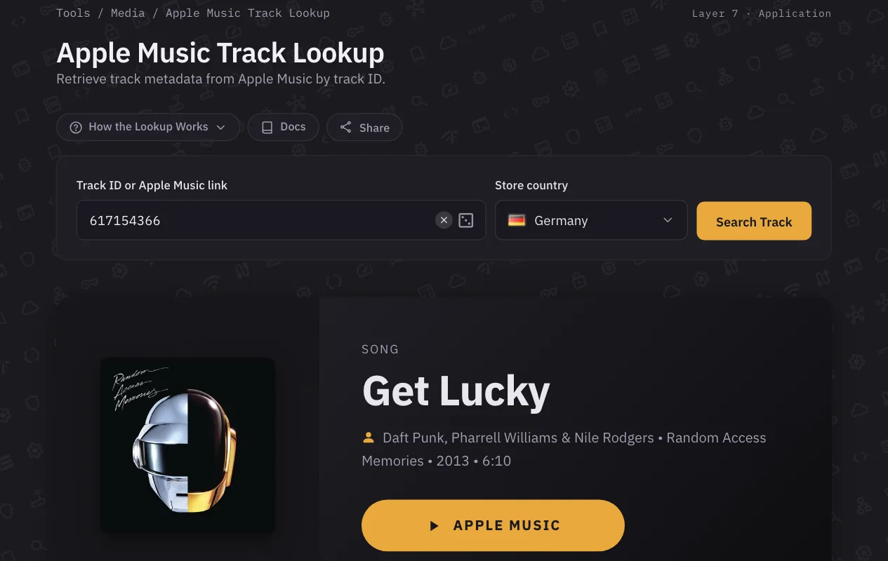

<p align="center">
<a href="https://troubleshooting.tools/lookup/apple/track"></a>
</p>

<h1 align="center">Apple Music Track Lookup</h1>

<p align="center">Look up an Apple Music track in the store of one specific country, in the browser or from a script.</p>

<p align="center"><a href="https://troubleshooting.tools/lookup/apple/track"><b>Open the tool</b></a> &nbsp;·&nbsp; <a href="https://troubleshooting.tools/docs/apple-music-track-lookup">Documentation</a> &nbsp;·&nbsp; <a href="https://disisto.de/project-apple-music-lookup">Project page</a></p>

<p align="center"></p>

## Contents

- [Features](#features)
- [On the web page](#on-the-web-page)
- [What it accepts](#what-it-accepts)
- [Links you can share](#links-you-can-share)
- [One number, many stores](#one-number-many-stores)
- [From the command line](#from-the-command-line)
- [Errors](#errors)
- [Where the data comes from](#where-the-data-comes-from)
- [Recipes](#recipes)
- [Privacy](#privacy)
- [Good to know](#good-to-know)

## Features

- Accepts a track number, a song address or an album address with `?i=`; the country in the address selects the store.
- Without an address, a searchable country picker decides which store is asked.
- Answers for exactly one store and says so when that store does not carry the number.
- Album numbers and items that are not songs, such as music videos, get a message of their own instead of a vague "not found".
- Lists names, genre and release date, the position on the release, duration, explicitness and streamability, plus the numbers of track, album and artist.
- Each lookup has its own address, and shared links carry the track in their preview.

## On the web page

1. Open <https://troubleshooting.tools/lookup/apple/track>.
2. Paste into **Track ID or Apple Music link** a number such as `617154366` or an address copied from Apple Music.
3. Check **Store country**. A pasted address sets it from its country part; otherwise pick a country from the searchable list.
4. Press **Search Track** or Enter. The dice button in the field picks a sample track.

The result has two parts:

| Part | What it shows |
|---|---|
| **Card** | Cover, title, artist, album, year, duration and an EXPLICIT tag where Apple sets one; **Apple Music** shows a confirmation before you leave for Apple |
| **Metadata** | Track Name, Artist, Album, Genre, Release Date, Track Number, Disc Number, Track Duration, Explicit, Streamable, Store, Track ID, Album ID and Artist ID, each one click to copy |

## What it accepts

| Input | Example | What happens |
|---|---|---|
| Track number | `617154366` | looked up in the selected store |
| Song address | `https://music.apple.com/de/song/get-lucky/617154366` | number taken from the end, store from `/de/` |
| Album address with a track | `https://music.apple.com/de/album/random-access-memories/617154241?i=617154366` | the number after `?i=` is the track; `617154241` is the album |
| Short address | `https://music.apple.com/de/song/617154366` | same as the song address |
| geo.music.apple.com address | `https://geo.music.apple.com/de/album/…?i=617154366` | handled like music.apple.com |

## Links you can share

Every lookup has a stable address that opens straight on the result:

| Store | Link |
|---|---|
| Germany | <https://troubleshooting.tools/lookup/apple/track/de/617154366> |
| United States (default) | <https://troubleshooting.tools/lookup/apple/track/617154366> |

The page is delivered with the answer already in it, and a link posted in a chat shows the track in its preview, for example *“Get Lucky by Daft Punk, Pharrell Williams & Nile Rodgers, from Random Access Memories, 6:10, Pop, released Apr 19, 2013.”*

**Search from the browser address bar.** Add a custom search engine with this URL and a keyword such as `am`:

```
https://troubleshooting.tools/lookup/apple/track/de/%s
```

Replace `de` with the store you work with most. Typing `am 617154366` then opens the lookup in that store.

## One number, many stores

A track number is the same in every country, but each country has its own catalogue. That is why every lookup names one store, and why the same number can give different answers:

| What can differ | Example |
|---|---|
| Whether the track is in the store at all | one store answers, another returns HTTP 404 |
| Names and genre | the Japanese store writes the artist as `ダフト・パンク` and the genre as `ポップ` |
| Price and currency | `EUR` in the German store, `JPY` in the Japanese one |
| Streamability | `isStreamable` can be true in one store and false in another |

A country that has no Apple store at all is reported as such, so a typo in the country code is not mistaken for a missing track.

## From the command line

The API lives at `https://api.troubleshooting.tools/v1`, needs no key and allows requests from any origin. It takes `trackid` and an optional two-letter `country`, by GET or POST:

```
GET  /lookup/apple/track?trackid={id}&country={cc}
POST /lookup/apple/track            (form fields trackid, country)
```

Without `country`, the US store is asked. Anything that is not a digit is removed from the ID.

```sh
curl -s "https://api.troubleshooting.tools/v1/lookup/apple/track?trackid=617154366&country=de" | jq .
```

The answer is Apple's record for exactly this track, plus a `cover` field (the album art's address on this site), shortened here:

```json
{
  "wrapperType": "track",
  "kind": "song",
  "trackId": 617154366,
  "collectionId": 617154241,
  "artistId": 5468295,
  "trackName": "Get Lucky",
  "artistName": "Daft Punk, Pharrell Williams & Nile Rodgers",
  "collectionName": "Random Access Memories",
  "primaryGenreName": "Pop",
  "releaseDate": "2013-04-19T07:00:00Z",
  "discNumber": 1,
  "discCount": 1,
  "trackNumber": 8,
  "trackCount": 13,
  "trackTimeMillis": 369629,
  "trackExplicitness": "notExplicit",
  "isStreamable": true,
  "country": "DEU",
  "currency": "EUR",
  "...": "..."
}
```

Fields worth knowing:

| Field | Meaning |
|---|---|
| `kind` | always `song`; other kinds are refused |
| `trackId`, `collectionId`, `artistId` | the numbers of track, album and artist |
| `trackExplicitness` | `explicit`, `cleaned` for an edited version, or `notExplicit` |
| `isStreamable` | whether the store marks the track as streamable |
| `trackTimeMillis` | duration in milliseconds |
| `discNumber` / `discCount`, `trackNumber` / `trackCount` | position on the release and its size |
| `country`, `currency` | which store answered (three-letter country code) and the currency it uses |
| `cover` | the album art as this site delivers it |

## Errors

Every error is JSON of the form `{"error": "..."}`:

| Case | Status | Message |
|---|---|---|
| missing or unusable `trackid`, malformed country | 400 | a short reason |
| country without an Apple store | 400 | `Apple has no store for the country code KP.` |
| number not in the chosen store | 404 | `No track with this ID in the DE store.` |
| number belongs to an album | 404 | `That number is an album, not a track. In an album address the track is the number after ?i=.` |
| item is not a song, e.g. a music video or an artist ID | 404 | `That number is not a song on Apple Music.` |
| Apple not reachable | 502 | |
| the lookup cannot run at the moment | 503 | |
| other methods | refused | |

```sh
curl -s "https://api.troubleshooting.tools/v1/lookup/apple/track?trackid=617154241&country=de"
# {"error":"That number is an album, not a track. In an album address the track is the number after ?i=."}
```

## Where the data comes from

| Information | Source |
|---|---|
| Track record | Apple's public iTunes lookup, asked by the server for the chosen store; answers are cached for up to seven days per store and number |
| Cover | fetched by the server in a larger size and delivered from this site |
| Store countries | a fixed list of countries that have an Apple store |

Every field and error case is described in the [documentation](https://troubleshooting.tools/docs/apple-music-track-lookup).

## Recipes

**Compare how two stores list the same track**

```sh
for cc in de jp; do
  printf "%s: " "$cc"
  curl -s "https://api.troubleshooting.tools/v1/lookup/apple/track?trackid=617154366&country=$cc" \
    | jq -r '"\(.artistName) / \(.primaryGenreName)"'
  sleep 1
done
# de: Daft Punk, Pharrell Williams & Nile Rodgers / Pop
# jp: ダフト・パンク, Pharrell Williams & ナイル・ロジャース / ポップ
```

**Check a list of stores for availability**

```sh
for cc in de us gb fr; do
  printf "%s: " "$cc"
  curl -s "https://api.troubleshooting.tools/v1/lookup/apple/track?trackid=617154366&country=$cc" \
    | jq -r '.trackName // .error'
  sleep 1
done
```

**Take the track number out of an album address**

```sh
URL='https://music.apple.com/de/album/get-lucky/617154241?i=617154366'
ID=$(printf '%s' "$URL" | sed -n 's/.*[?&]i=\([0-9]*\).*/\1/p')
curl -s "https://api.troubleshooting.tools/v1/lookup/apple/track?trackid=$ID&country=de" | jq -r .trackName
# Get Lucky
```

**Title, artist and duration in one line**

```sh
curl -s "https://api.troubleshooting.tools/v1/lookup/apple/track?trackid=617154366&country=de" \
  | jq -r '(.trackTimeMillis/1000|floor) as $s | "\(.trackName) – \(.artistName) (\($s/60|floor):\(if $s%60<10 then "0" else "" end)\($s%60))"'
# Get Lucky – Daft Punk, Pharrell Williams & Nile Rodgers (6:09)
```

**From JavaScript on your own page**

```js
const res = await fetch("https://api.troubleshooting.tools/v1/lookup/apple/track?trackid=617154366&country=de");
const t = await res.json();
console.log(t.error ?? `${t.trackName} (${t.collectionName}), streamable: ${t.isStreamable}`);
```

## Privacy

- Your browser sends only the track number and the country to the site. The server asks Apple's public lookup service, and the cover is delivered by the site as well.
- There are no previews, no embeds and no map; leaving for Apple Music always needs a confirmation first.
- The tool sets no cookies.

## Good to know

- Answers are cached for up to seven days per store and number, so a change in Apple's catalogue can take that long to show.
- The duration in the preview text is rounded; `trackTimeMillis` holds the exact value.
- Store-specific names come back as that store writes them, in other scripts too.
- The service is reached over IPv4.

---

<sub>Part of <a href="https://troubleshooting.tools">troubleshooting.tools</a>. Not affiliated with <a href="https://music.apple.com/">Apple Music</a>. All mentioned trademarks are the property of their respective owners.</sub>
